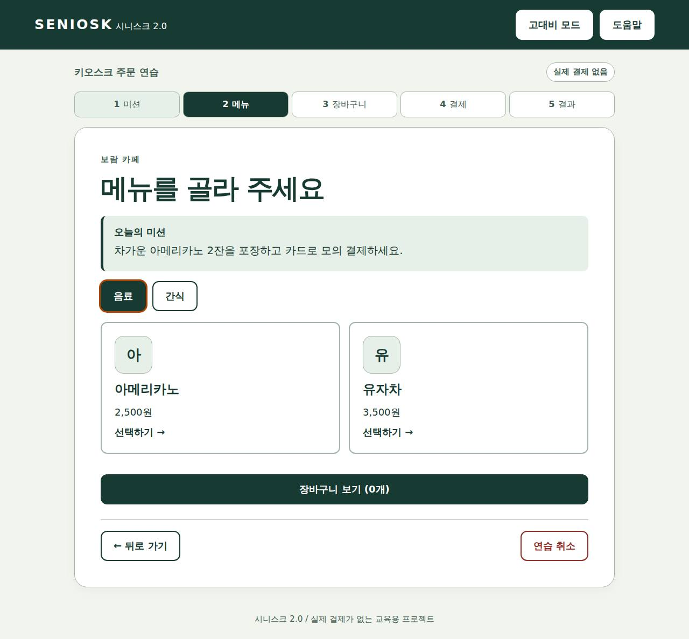
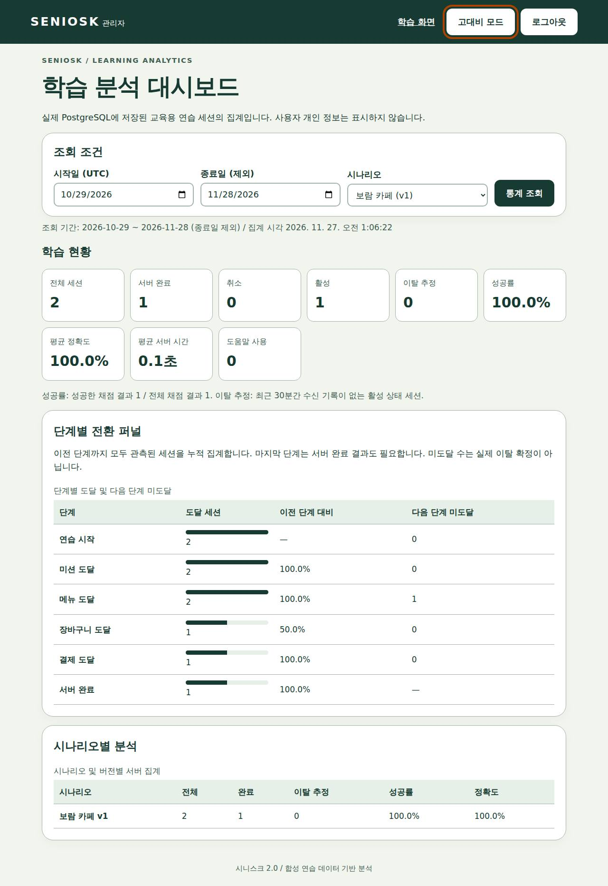
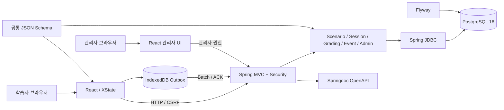
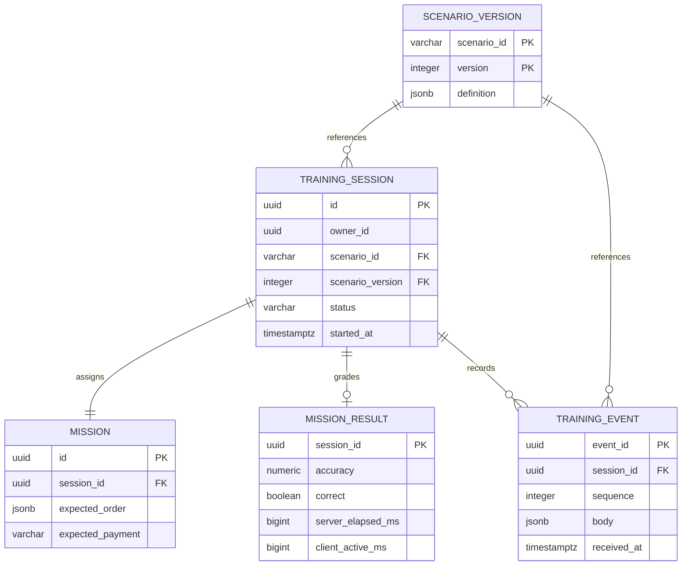
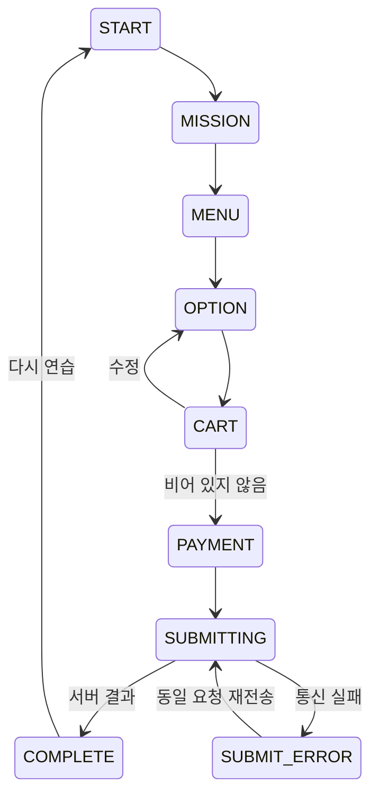
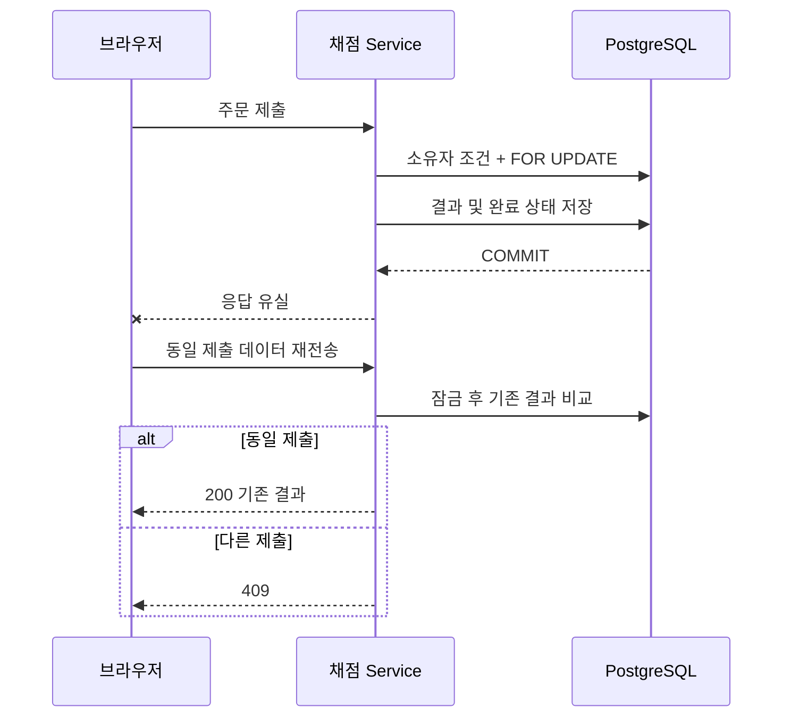
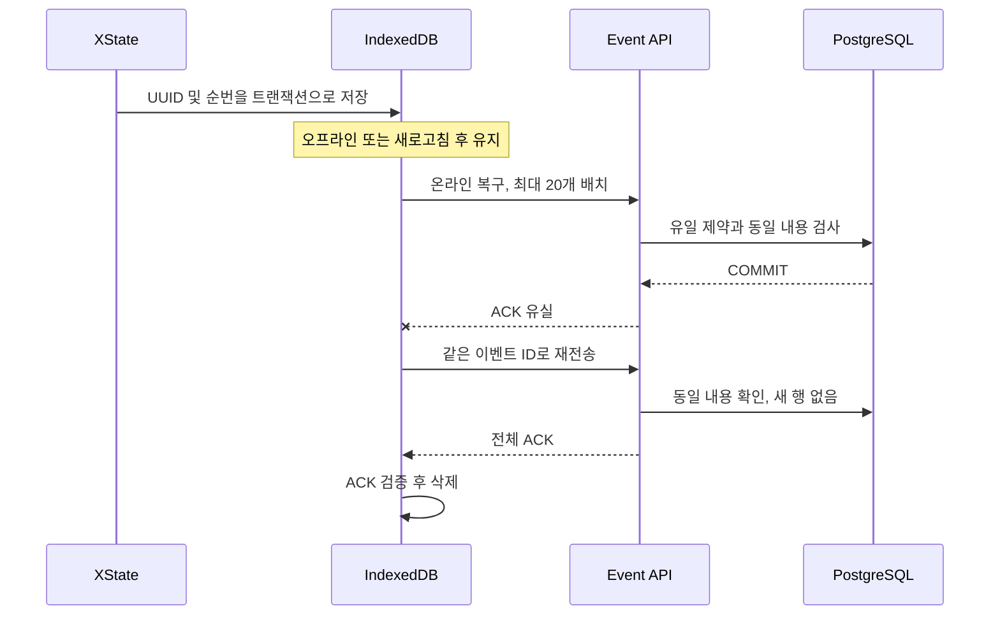

<div align="center">

# SENIOSK 2.0 | 시니스크

**실제 결제 없이 반복하는 키오스크 주문 연습, 서버가 확인하는 학습 결과**

Java 21 / Spring Boot / PostgreSQL / React / TypeScript

[실행 방법](#6-실행-방법) | [기술 설계](#4-시스템-설계) | [검증 결과](#7-검증-결과) | [엔지니어링 문서](docs/index.md)

</div>

## 1. 프로젝트 소개

디지털 기기에 익숙하지 않은 사람이 실제 매장에서 주문하기 전에 메뉴 선택부터 모의 결제까지 반복해서 연습할 수 있는 웹 서비스입니다. 가상의 보람 카페와 도란 버거에서 주어진 미션을 수행하면 서버가 주문 결과를 채점합니다. 관리자는 개인 정보가 아닌 세션 단위의 학습 통계를 확인할 수 있습니다.

V2는 기존 Django 프로젝트에서 발견된 데이터 공유 결함과 측정의 한계를 Spring Boot 기반 구조로 개선한 리엔지니어링 프로젝트입니다. 새로운 기능의 수보다 재현 가능한 오류 해결과 데이터 정합성에 중점을 둡니다.

> 로컬 실행용 M1 개발 범위입니다. 관리자 기능까지 전체 CI를 통과했으며 최종 시연 캡처와 재검증을 진행 중입니다. 실제 이용자 연구, 운영 배포 및 대량 성능 시험은 수행하지 않았습니다.

## 2. 문제 정의 및 개선

| 기존 V1의 문제 | V2의 해결 방법 | 검증 |
|---|---|---|
| 전역 장바구니로 다른 사용자의 주문이 공유될 수 있음 | 서버 세션 소유자 조건과 PostgreSQL 행 잠금 | Django 결함 재현 및 V2 교차 세션 테스트 |
| 공유 미션과 난수 기반 결과 | 미션 스냅샷과 결정론적 서버 채점 | 단위 테스트 및 DB 트랜잭션 검증 |
| 브랜드별 별도 화면 | 버전이 있는 공통 JSON Schema와 XState | 두 매장의 실제 주문 성공 |
| 통신 장애 시 행동 기록 손실 위험 | IndexedDB Outbox와 멱등 배치 수집 | 오프라인, 새로고침, ACK 유실 검증 |
| 실제 학습 과정 분석의 한계 | 인증된 관리자와 세션 단위 집계 | PostgreSQL 합성 데이터, EXPLAIN, 브라우저 검증 |

[기존 코드 분석](docs/research/V1_BASELINE.md) / [기존 main 브랜치](https://github.com/ElephantAnthony/kiosk-web/tree/main)

## 3. 서비스 기능 및 실제 화면

### 학습자: 미션부터 결과까지

보람 카페에서는 음료와 간식, 도란 버거에서는 버거 등 서로 다른 메뉴를 동일한 렌더러에서 선택합니다. 필수 옵션, 수량, 매장 이용 또는 포장 여부와 모의 결제 수단을 선택하고 주문을 제출합니다.



위 화면은 실제 Chromium에서 캡처했습니다. [출처 및 무결성 증빙](docs/evidence/runs/SEN-04-pass-45775831858.md)

<!-- RELEASE_GALLERY -->

- 서버가 정한 미션 안내, 도움말, 뒤로 가기와 장바구니 수정
- 필수 옵션 검증, 빈 장바구니 결제 차단
- 서버 결과가 도착한 후에만 완료 처리
- 응답 유실 시 동일 주문으로 재시도, 서버 확인 후 취소
- 키보드 조작, 고대비 전환, 포커스 표시와 큰 버튼

### 관리자: 실제 PostgreSQL 학습 분석



Playwright에서 합성 연습 세션으로 실행한 실제 관리자 화면입니다. 실사용자 통계가 아닙니다. [검증 근거](docs/evidence/runs/SEN-06-pass-45920332880.md)

관리자 로그인 후 날짜 및 시나리오를 필터링하여 전체, 완료, 취소, 활성, 이탈 추정 세션 수와 성공률, 평균 정확도, 서버 경과 시간, 도움말 사용을 확인합니다. 단계별 퍼널은 중복 이벤트를 제외한 세션 단위 관측값입니다. 30분 기준 이탈 추정은 실제 포기 여부를 확정하지 않습니다. 빈 분모는 비율을 계산하지 않습니다.

[집계 정의와 분모](docs/design/FUNNEL.md) / [인증 및 집계 ADR](docs/adr/006-admin-and-funnel.md)

## 4. 시스템 설계



| 계층 | 기술 | 선택 이유 |
|---|---|---|
| Frontend | React 19, TypeScript, Vite, XState 5 | 명시적인 화면 상태와 타입 기반 데이터 처리 |
| Backend | Java 21, Spring Boot 3.5.16, MVC, Security, JDBC | 모듈 단위 분리, 트랜잭션과 행 잠금의 직접 제어 |
| Database | PostgreSQL 16, Flyway | JSONB, 유일 제약조건, 스키마 버전 관리 |
| Contract | JSON Schema 2020-12, Ajv, networknt, OpenAPI 3.1 | 서버와 브라우저의 공통 데이터 검증 |
| Test | JUnit, MockMvc, Vitest, Playwright, axe-core | 실제 DB 및 브라우저 회귀 검증 |
| DevOps | Docker Compose, GitHub Actions, Gitleaks | 재현 가능한 실행 및 자동 검증 |

외부 AI 호출, 실결제 시스템, 추가 메시지 브로커나 유료 인프라는 사용하지 않습니다.

### 데이터베이스 ERD



미션과 결과는 세션당 최대 1행, 이벤트는 event_id 및 (session_id, sequence) 유일 제약조건을 가집니다. V4는 시작 시각 및 시나리오 집계용 인덱스를 추가합니다. [전체 ERD와 제약조건](docs/design/ERD.md)

### 상태 머신



위 다이어그램은 정상 주문 및 재시도 핵심 경로입니다. 실제 취소, 도움말, 뒤로 가기와 오류 전이는 [전체 상태 머신](docs/design/KIOSK_FLOW.md)을 참고하세요.

## 5. 기술적 문제 해결

### 5-1. 동시 요청에도 동일한 결과 유지

메뉴 ID, 정렬된 옵션, 포장 여부를 복합 키로 만들고 동일 키의 수량을 합산합니다. 서버에 저장된 미션과 주문을 비교하여 일치, 누락, 초과 수량을 구합니다.

정확도 = matched / (matched + missing + extra). 정답은 누락과 초과가 모두 0이고 모의 결제 수단까지 같을 때입니다.

| 정답: 차가운 아메리카노 2잔 포장 | 일치 | 누락 | 초과 | 정확도 |
|---|---:|---:|---:|---:|
| 정확한 주문 | 2 | 0 | 0 | 100% |
| 1잔만 주문 | 1 | 1 | 0 | 50% |
| 3잔 주문 | 2 | 0 | 1 | 66.67% |
| 다른 온도로 주문 | 0 | 2 | 2 | 0% |



서버 경과 시간과 브라우저가 보고하는 활동 시간은 분리하여 저장합니다. [채점 ADR](docs/adr/003-grading-and-idempotency.md)

### 5-2. 매장이 달라도 동일한 주문 엔진

시나리오를 JSON 계약으로 분리하고 백엔드와 프론트엔드가 같은 스키마를 사용합니다. 두 번째 매장 추가 [커밋 f4668ee](https://github.com/ElephantAnthony/kiosk-web/commit/f4668ee64cfe573e6bc14b4661f7786f0b9914ec)은 JSON 파일 1개만 추가했습니다. 렌더러와 상태 머신 변경은 0줄이며 실제 브라우저에서 두 매장의 정상 주문을 검증했습니다.

[시나리오 계약](v2/contracts/scenario.schema.json) / [보람 카페](v2/contracts/scenarios/boram-cafe.v1.json) / [도란 버거](v2/contracts/scenarios/doran-burger.v1.json)

### 5-3. 오프라인 저장 및 ACK 유실 복구



5초 또는 20개 기준 배치, 지수 백오프와 jitter, HTTP 429 Retry-After를 적용합니다. 동일 ID의 다른 내용은 409로 거부하며 전체 배치를 롤백합니다. 실제 Chromium에서 오프라인 이벤트 8개 복구 및 ACK 유실을 검증했습니다. 429는 테스트에서 주입한 응답입니다. [이벤트 설계](docs/design/EVENT_PIPELINE.md)

### 5-4. 신뢰 가능한 집계와 접근 권한

관리자용 Spring Security 컨텍스트를 학습자 소유권과 분리합니다. 환경변수로 유효한 계정이 설정되지 않으면 관리자 로그인이 비활성화됩니다. 비밀번호는 시작 시 BCrypt로 해싱하고 로그인 시 세션 ID와 CSRF 토큰을 변경합니다.

집계는 이벤트를 세션별 한 행으로 먼저 축약한 뒤 서버 채점 결과와 결합합니다. 합성 5개 세션의 전체/완료/취소/활성/이탈 추정 = 5/2/1/1/1, 관측 퍼널 = 5/5/4/2/1/1로 검증했습니다. 실제 EXPLAIN에서 날짜 범위, 결과 PK, 세션별 이벤트 인덱스 사용을 확인했습니다. 이는 운영 성능 측정이 아닙니다.

[집계 테스트 및 EXPLAIN](docs/evidence/runs/SEN-06-backend-45919907679.md)

## 6. 실행 방법

Docker Desktop 또는 Docker Engine과 Compose v2를 준비합니다. Windows PowerShell:

```powershell
git clone -b portfolio/seniosk-v2 https://github.com/ElephantAnthony/kiosk-web.git
cd kiosk-web/v2
Copy-Item .env.example .env
notepad .env
docker compose up --build -d --wait
```

.env에서 DB_PASSWORD를 직접 설정하세요. 관리자를 사용하려면 ADMIN_USERNAME과 ADMIN_PASSWORD도 설정합니다. 관리자 비밀번호는 최소 16자, UTF-8 최대 72바이트입니다. 비밀번호는 Git에 커밋하지 않습니다.

| 주소 | 기능 |
|---|---|
| http://localhost:5173 | 학습자 화면 |
| http://localhost:5173/admin | 관리자 화면 |
| http://localhost:8080/healthz | DB 연결 상태 |
| http://localhost:8080/swagger-ui.html | API 문서 |

종료는 v2에서 `docker compose down`을 실행합니다. 기존 데이터 볼륨은 유지됩니다. `down -v`는 데이터 삭제이므로 일반 종료에 사용하지 않습니다. 모든 포트는 루프백에 바인딩하는 로컬 데모입니다.

[상세 실행 및 장애 확인](docs/release/RUNBOOK.md)

## 7. 검증 결과

[관리자 완료 CI 45920332880](https://github.com/ElephantAnthony/kiosk-web/actions/runs/45920332880): 전체 5개 Job 성공.

| 검증 | 관측 결과 |
|---|---|
| JUnit 단위 | 22개 통과 |
| 실제 PostgreSQL 통합 | 26개 통과 |
| Vitest | 23개 통과 |
| Chromium Playwright | 10개 통과 |
| 기존 Django 결함 재현 | 1개 통과 |
| OpenAPI 실제 재생성 diff | 일치 |
| Compose 전체 기동 및 health | 통과 |
| ESLint, typecheck, build | 통과 |
| Gitleaks | 236개 커밋 검사, 미분류 탐지 0건 |

테스트 합계 82개(브라우저, V1 포함). 자동 접근성 검사는 검사한 화면에서 serious/critical 위반 0건을 요구합니다. 전체 WCAG 인증이나 실제 사용자 개선 효과를 의미하지 않습니다. [최종 관리자 검증](docs/evidence/runs/SEN-06-pass-45920332880.md)

최종 시연 및 추가 접근성 검사 CI: [45922321237](https://github.com/ElephantAnthony/kiosk-web/actions/runs/45922321237), 결과 확인 전.

소스 전체 검증은 Java 21, Maven, Node 22.16, npm 11.21.2, Docker, openssl 및 Git Bash/WSL/Linux 환경에서 저장소 루트 기준 `bash v2/scripts/verify`를 실행합니다. 관리자 환경변수도 셸에 설정해야 합니다. [검증 체크리스트](docs/release/CHECKLIST.md)

## 8. API 및 프로젝트 구조

| HTTP | Endpoint | 기능 |
|---|---|---|
| GET | /healthz | DB 연결 |
| GET | /api/scenarios, /api/scenarios/{scenarioId}/{version} | 시나리오 조회 |
| GET | /api/csrf | 세션 기반 CSRF |
| POST | /api/sessions | 미션과 학습 세션 생성 |
| GET | /api/sessions/{id} | 소유 세션 조회 |
| POST | /api/sessions/{id}/submit | 주문 제출 및 채점 |
| GET | /api/sessions/{id}/result | 결과 조회 |
| POST | /api/sessions/{id}/cancel | 취소 |
| POST | /api/sessions/{id}/events | 이벤트 배치 수집 |
| POST | /api/admin/login | 관리자 로그인 |
| GET | /api/admin/me | 인증 상태 |
| GET | /api/admin/funnel | 집계 조회 |
| POST | /api/admin/logout | 로그아웃 |

[실제 생성 OpenAPI](v2/contracts/openapi.json) / [API 계약 설명](docs/design/API.md)

```text
.
├── AGENTS.md
├── docs/
│   ├── adr/           기술 결정
│   ├── design/        ERD, API, 상태 머신, 이벤트 및 퍼널
│   ├── evidence/      테스트 증빙, 실제 화면
│   ├── learning/      기술 학습
│   ├── prompts/       작업별 수용 기준
│   ├── release/       릴리스 및 운영 가이드
│   └── troubleshooting/
├── v2/
│   ├── backend/       Spring MVC, Service, JDBC Repository, Flyway
│   ├── contracts/     JSON Schema, 시나리오, OpenAPI
│   ├── frontend/      React, XState, IndexedDB SDK, E2E
│   ├── scripts/
│   └── docker-compose.yml
└── V1 Django 애플리케이션 소스 (보존)
```

## 9. 개발 이력과 하네스 엔지니어링

| 단계 | 작업 |
|---|---|
| 00~01 | 기존 결함 분석, 저장소 정리, Spring/React 실행 기반 |
| 02 | 공통 계약, 시나리오, 학습 세션 |
| 03 | 서버 채점, 결과 저장, 동시성 |
| 04 | 키오스크 화면과 상태 머신, 두 번째 매장 |
| 05 | 영속 이벤트 Outbox 및 멱등 수집 |
| 06 | 관리자 인증과 행동 분석 |
| 07 | 최종 검증과 실제 시연 자료, 문서 정리 |

수용 기준을 프롬프트로 기록하고, 기능별 소스 변경과 테스트 실패/수정/재검증을 Git 커밋으로 보존합니다. AI 지원을 활용한 리엔지니어링이며 개인의 구현 이해도와 실제 기여 범위는 별도 확인이 필요합니다.

[작업 규칙](AGENTS.md) / [진행 계획](docs/PLAN.md) / [전체 기술 문서](docs/index.md) / [검증 증빙](docs/evidence/INDEX.md) / [트러블슈팅](docs/release/TROUBLESHOOTING.md) / [면접 학습](docs/learning/phase-7.md) / [커밋 기록](https://github.com/ElephantAnthony/kiosk-web/commits/portfolio/seniosk-v2/)

## 10. 한계 및 후속 과제

- 실제 학습자 대상으로 사용성, 학습 향상률, 접근성을 검증하지 않았습니다.
- 운영 배포, TLS 운영 설정, 다중 서버 세션, MFA, 관리자 계정 수명주기 및 로그인 rate limit은 구현하지 않았습니다.
- 네트워크 장애 복구는 테스트한 범위에서 확인했습니다. 저장소 삭제, 세션 만료, 브라우저 강제 종료 전 미완료 트랜잭션까지 보장하지 않습니다.
- 새로고침 시 장바구니 복구는 미구현이고 세션 시작 응답 유실 시 고립된 활성 세션이 생길 수 있습니다.
- pagehide 전송은 최선형 방식이며 독립된 종료 상황 시험은 미실행입니다.
- 30분 이탈 추정과 행동 이벤트는 실제 포기나 학습 효과의 증거가 아닙니다.
- 대량 성능, 부하, 침투 및 의존성 취약점 전수 검사는 미실행입니다. Gitleaks는 비밀정보 탐지 검사입니다.

[보안 및 한계 상세](docs/release/SECURITY.md) / [릴리스 검토](docs/release/REVIEW.md)

문서 구성 참고: [Jumi 캡스톤 프로젝트](https://github.com/kookmin-sw/capstone-2024-24). 기능 설명과 시연 중심의 전달 방식만 참고했으며 소스와 화면은 복제하지 않았습니다.
