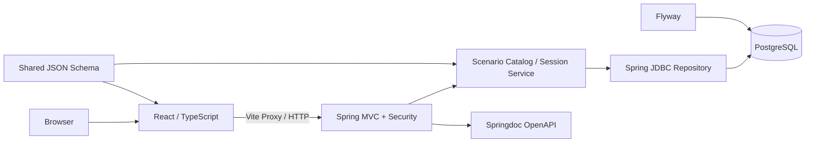
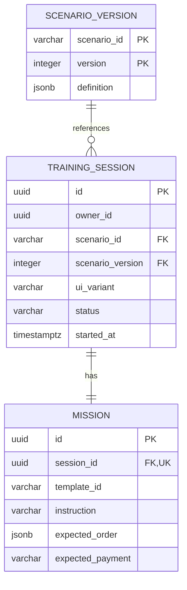

# SENIOSK 2.0 | 시니스크

**키오스크 주문을 반복 연습할 수 있는 교육용 웹 서비스**

시니스크는 기존 Django 기반 키오스크 프로젝트의 장바구니 공유 결함과 부정확한 측정 문제를 재현하고, Java 21과 Spring Boot 기반으로 개선하는 개발 프로젝트입니다. 실제 브랜드, 결제, 참여자 데이터 없이 가상의 주문 연습 환경을 구축합니다.

> 현재 상태: 개발 환경 검증 완료, 시나리오와 학습 세션 API 구현. 서버 채점, 실제 주문 화면, 행동 로그 및 관리자 화면은 후속 개발 범위입니다.

## 1. 프로젝트의 문제와 개선 방향

| 기존 V1 문제 | V2 개선 설계 | 확인 상태 |
|---|---|---|
| 전역 장바구니 사용 | 사용자별 HttpSession과 소유자 조건이 있는 DB 조회 | 실제 동시 세션 통합 테스트 통과 |
| 공유 미션과 난수 기반 점수 | 세션별 미션 스냅샷, 서버 채점 예정 | 미션 저장 통과, 채점 미구현 |
| 브랜드별 UI 분리 | 공통 시나리오 JSON 계약 | Java/Ajv 검증 통과, 화면 엔진 미구현 |
| 장애 시 기록 손실 가능성 | IndexedDB outbox와 멱등 수집 예정 | 미구현 |

기존 V1의 장바구니 공유 문제는 Django test client 두 개를 사용해 재현했습니다. 원본 main 브랜치는 변경하지 않습니다.

## 2. 실행 방법

필요 환경: Docker Desktop 또는 Docker Engine + Compose v2. 소스 검증 시 Java 21, Maven, Node 22.16 이상, npm 11.21.2, openssl, Git Bash/WSL/Linux.

```bash
git clone -b portfolio/seniosk-v2 https://github.com/ElephantAnthony/kiosk-web.git
cd kiosk-web/v2
cp .env.example .env
# .env의 DB_PASSWORD에 로컬 개발용 비밀번호를 설정
docker compose up --build -d --wait
```

- React: http://localhost:5173
- Spring Boot: http://localhost:8080/healthz
- Swagger UI: http://localhost:8080/swagger-ui.html
- 종료: `docker compose down` (기존 볼륨은 보존)

서비스는 로컬 루프백 인터페이스에 바인딩합니다. 실제 사용자나 결제정보는 입력하지 않습니다. 운영 배포는 현재 범위가 아닙니다.

## 3. 구현된 기능

### 시나리오 계약

가상의 **보람 카페** 시나리오에 음료, 간식, 가격, 옵션 그룹, 포장 및 결제 선택, 미션을 JSON으로 정의했습니다. Java의 networknt와 TypeScript의 Ajv가 동일한 JSON Schema Draft 2020-12 파일을 사용합니다. 서버는 메뉴 참조, 옵션 그룹 선택 및 식별자 중복도 검증합니다.

[공통 JSON Schema](v2/contracts/scenario.schema.json) / [카페 데이터](v2/contracts/scenarios/boram-cafe.v1.json)

### 학습 세션 및 미션

- 시나리오 ID와 버전으로 학습 세션을 시작합니다.
- 서버가 미션과 시작 시각을 생성합니다.
- 시나리오 버전과 미션의 기대 주문이 PostgreSQL에 저장됩니다.
- 세션 생성 및 미션 저장이 하나의 트랜잭션에서 처리됩니다.
- CSRF 검증 및 서버의 소유자 식별 조건으로 교차 조회를 차단합니다.

이는 익명 브라우저 세션 격리입니다. 회원가입, 관리자 인증, 다중 서버 세션 공유를 구현했다는 의미가 아닙니다.

## 4. 아키텍처



| 계층 | 기술 |
|---|---|
| Frontend | React 19, TypeScript, Vite, Ajv 8.17.1 |
| Backend | Java 21, Spring Boot 3.5.16, Spring MVC, Security, JDBC |
| Contract | JSON Schema Draft 2020-12, networknt 1.5.9, OpenAPI 3.1 |
| Database | PostgreSQL 16, Flyway |
| Test | JUnit, MockMvc, Vitest, Playwright, axe-core |
| DevOps | Docker Compose, GitHub Actions, Gitleaks, npm lockfile |

XState는 이후 키오스크 주문 상태 머신에서 사용할 예정입니다. 외부 AI 호출이나 유료 인프라에 의존하지 않습니다.

## 5. 데이터베이스 설계



[ERD 상세 설명](docs/design/ERD.md) / [Flyway V1 SQL](v2/backend/src/main/resources/db/migration/V1__training_domain.sql)

## 6. REST API

| Method | Endpoint | 기능 |
|---|---|---|
| GET | /healthz | DB 연결 상태 확인 |
| GET | /api/scenarios | 시나리오 목록 |
| GET | /api/scenarios/{scenarioId}/{version} | 시나리오 버전 조회 |
| GET | /api/csrf | 세션 기반 CSRF 토큰 |
| POST | /api/sessions | 학습 세션과 미션 생성 |
| GET | /api/sessions/{id} | 소유한 세션 조회 |

PowerShell에서 가상 세션 생성 예시:

```powershell
$base = 'http://localhost:5173'
$csrf = Invoke-RestMethod "$base/api/csrf" -SessionVariable web
$body = @{scenarioId='boram-cafe'; version=1; uiVariant='standard'} | ConvertTo-Json
$result = Invoke-RestMethod "$base/api/sessions" -Method Post -WebSession $web -Headers @{'X-CSRF-TOKEN'=$csrf.token} -ContentType 'application/json' -Body $body
Invoke-RestMethod "$base/api/sessions/$($result.id)" -WebSession $web
```

[생성된 OpenAPI 3.1](v2/contracts/openapi.json) / [API 설명](docs/design/API.md)

## 7. 프로젝트 구조

```text
.
├── AGENTS.md
├── docs/
│   ├── adr/          # 기술 결정
│   ├── decisions/    # 승인된 범위
│   ├── design/       # ERD, API
│   ├── evidence/     # 실제 검증 결과
│   ├── learning/     # 학습 및 면접 대비
│   ├── prompts/      # 작업 단위 프롬프트
│   └── PLAN.md
├── v2/
│   ├── backend/
│   │   └── src/main/java/com/seniosk/
│   │       ├── common/
│   │       ├── config/
│   │       ├── health/
│   │       ├── scenario/
│   │       ├── session/
│   │       └── mission/
│   ├── contracts/    # JSON Schema, fixture, OpenAPI
│   ├── frontend/
│   │   ├── src/api/
│   │   ├── src/scenario/
│   │   └── e2e/
│   ├── scripts/verify
│   └── docker-compose.yml
└── 기존 V1 Django 코드 (보존)
```

## 8. 실제 검증 결과

| 검증 | 증빙 |
|---|---|
| 기존 결함 재현 | Django test client 2개, characterization test 1개 PASS |
| 개발 환경 | [CI 45771026505](https://github.com/ElephantAnthony/kiosk-web/actions/runs/45771026505), 5개 Job PASS |
| 초기 화면 브라우저 및 접근성 | Chromium 1개 테스트 PASS, axe serious/critical 위반 0건 |
| 도메인 Java 테스트 | [CI 45772148779](https://github.com/ElephantAnthony/kiosk-web/actions/runs/45772148779), 단위 8개 + PostgreSQL 통합 5개 PASS |
| 프론트엔드 계약 테스트 | Vitest 8개 PASS, lint/typecheck/build PASS |
| 보안 검사 | 206개 커밋 검사, 검증된 과거 오탐 6개 외 미분류 탐지 0건 |
| OpenAPI | CI 생성본 SHA-256 확인, 커밋 및 strict diff 통과 |
| 도메인 프록시 E2E | 최종 통합 검증 진행 중 |

[초기 화면 실제 브라우저 보고서](https://github.com/ElephantAnthony/kiosk-web/actions/runs/45771026505/artifacts/15094117044) / [도메인 검증 기록](docs/evidence/runs/SEN-02-domain-45772148779.md)

브라우저 접근성 테스트는 초기 화면의 일부 자동 기준만 검증하며 WCAG 준수 인증을 의미하지 않습니다. 사용성 개선률과 운영 성능 수치는 실제 측정하지 않았습니다.

전체 로컬 검증은 저장소 루트에서 `bash v2/scripts/verify`로 실행합니다. 통합 테스트는 별도의 임시 PostgreSQL 컨테이너를 사용해 로컬 개발 데이터와 분리합니다.

## 9. 하네스 엔지니어링

- [AGENTS.md](AGENTS.md): 작업 규칙, 정지 조건, 검증 명령
- [작업 계획 및 재개](docs/PLAN.md): 실제 완료 상태와 다음 작업
- [작업 프롬프트](docs/prompts/SEN-02.md): 수용 기준
- [기술 결정](docs/adr/002-scenario-session-contract.md): 기술 선택과 대안
- [증빙 색인](docs/evidence/INDEX.md): 성공 및 실패 기록
- [학습 노트](docs/learning/phase-2.md): 구현 원리 및 면접 질문

## 10. 다음 개발 단계

서버의 결정론적 채점, 주문 제출 및 중복 처리, XState 주문 흐름, 접근성 개선, 오프라인 이벤트 재전송, 관리자 분석을 순서대로 개발합니다. 실제 테스트가 통과한 결과만 완료로 표시합니다.

최신 검증: [CI 45772447666](https://github.com/ElephantAnthony/kiosk-web/actions/runs/45772447666). OpenAPI 재생성 및 byte-for-byte diff 통과. 백엔드, 프론트엔드, V1, 보안 검사 통과. Compose/브라우저 최종 결과 확인 전. [실행 증빙](docs/evidence/runs/SEN-02-strict-45772447666.md)
