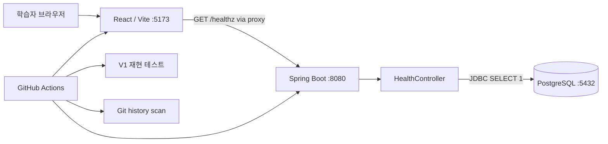

<div align="center">

# SENIOSK 2.0
### 시니스크 | 스스로 주문할 수 있도록 돕는 키오스크 연습 플랫폼

**대신 해주는 기술이 아니라, 스스로 할 수 있게 돕는 기술.**

Accessible kiosk training / reliable learning records

Java 21 / Spring Boot / React / TypeScript / PostgreSQL

[프로젝트 소개](#프로젝트-소개) | [아키텍처](#시스템-아키텍처) | [실행-방법](#실행-방법) | [검증-결과](#검증-결과) | [개발-기록](#개발-기록)

</div>

> **개발 상태: Foundation / 검증 보류**
> Spring 기반 서버의 Maven 빌드와 단위 테스트 3개가 통과했습니다.
> React 의존성 설치, lint, 타입 검사, 단위 테스트 4개, 빌드 및 Git 이력 보안 검사가 통과했습니다. Docker 기동 및 DB 연결은 확인했으며, 고정 lockfile과 Ubuntu 24.04 기반 최종 브라우저 검증이 필요합니다.
> 주문 연습 기능은 아직 미구현이며, 현재 브랜치는 배포 또는 완성된 서비스가 아닙니다.

## 프로젝트 소개

시니스크는 키오스크 사용이 익숙하지 않은 사람이 실제 매장을 방문하기 전에 주문 과정을 반복 연습할 수 있도록 설계하는 교육용 웹 서비스입니다. 실제 카드 정보나 결제는 사용하지 않습니다. 학습자가 자신의 속도로 메뉴와 옵션을 선택하고 주문을 확인하도록 돕는 것이 목표입니다.

V2는 기존 Django 프로토타입에서 발견한 세션 공유와 부정확한 결과 측정 문제를 해결하기 위해 Spring Boot와 React 기반으로 새롭게 구성합니다. 단순히 화면을 재현하는 것을 넘어, 정확한 채점과 신뢰할 수 있는 행동 기록을 목표로 합니다.

### 무엇이 달라지는가

| 구분 | V1 (2023, 기존 main 기준) | V2 (현재 개발 브랜치) |
|---|---|---|
| 서버 | Django 템플릿 및 Python | Spring Boot REST API 기반 작성 |
| UI | 브랜드별 HTML 및 JS | React 및 TypeScript 기반 작성 |
| 사용자 세션 | 프로세스 전역 장바구니 공유 결함 재현 | DB 기반 분리 예정 |
| 학습 점수 | 일부 난수 기반 저장 (소스 확인) | 서버의 결정론적 채점 예정 |
| 학습 행동 | 제한적인 클릭 기록 | IndexedDB 큐와 멱등 수집 예정 |
| 개발 검증 | 기존 테스트 스텁 | Maven 테스트 3개 통과, V1 재현 1개 통과 |
| 배포 방식 | 기존 실행 환경 | Docker 서비스 기동 및 DB 연결 확인, 브라우저 검증 대기 |

기존 코드 감사: [V1 baseline](docs/research/V1_BASELINE.md). 원본 브랜치와 팀 프로젝트 소스를 보존합니다.

## 핵심 기능

| 기능 | 제공 가치 | 현재 상태 |
|---|---|---|
| 서비스 연결 확인 | DB 연결 상태를 화면으로 전달 | 서버 테스트 및 실제 DB 연결 통과, React 빌드 통과 |
| 가상 카페 주문 연습 | 실제 결제 없이 연습 | 예정 |
| 미션 및 주문 채점 | 동일한 입력에 일관된 결과 | 예정 |
| 사용자 세션 격리 | 서로 다른 학습자의 상태 분리 | 예정 |
| 오프라인 이벤트 전송 | 연결 장애에도 기록 보존 | 예정 |
| 관리자 퍼널 | 학습 단계별 집계 | 예정 |
| 접근성 | 큰 버튼, 키보드 및 명확한 상태 안내 | 초기 화면 CSS 및 검사 코드 작성, 최종 axe 검증 대기 |

시연 화면과 영상은 실제 실행에 성공한 후 등록합니다. 현재는 소스와 테스트 결과만 공개합니다.

## 기술 스택

| 계층 | 기술 | 선정 이유 |
|---|---|---|
| Backend | Java 21, Spring Boot 3.5.16 | 타입 기반 API 및 표준화된 웹 계층 |
| Data | JDBC, PostgreSQL 16, Flyway | SQL의 명시적 제어와 향후 스키마 버전 관리 |
| Security | Spring Security | 공개 경로 최소화, CSRF 보호 유지 |
| Frontend | React 19, TypeScript, Vite | 컴포넌트 재사용, 상태 표현 및 타입 검사 |
| State | XState | 주문 단계 모델링 예정, 의존성 선언 |
| Verification | JUnit 5, MockMvc, Vitest, Playwright, axe | API, UI 및 접근성 검증 |
| Environment | Docker Compose, GitHub Actions | 로컬 환경 재현 및 반복 검증 |

Spring JDBC를 선택한 이유는 향후 이벤트 중복 제어에서 PostgreSQL의 UNIQUE와 INSERT ON CONFLICT를 명시적으로 다루기 위해서입니다. 현재는 DB 상태 확인에 JDBC를 사용합니다. [ADR-001](docs/adr/001-spring-modular-monolith.md)

## 시스템 아키텍처

아래 구성도는 이번 단계에서 작성한 소스와 실행 환경을 나타냅니다. 전체 기동 검증은 아직 통과하지 못했습니다.



V2 주문 및 분석 모듈은 추후 같은 서버의 기능별 패키지에 추가합니다. M1에서는 별도 마이크로서비스나 외부 AI 호출을 사용하지 않습니다.

### 연결 상태 API

| 요청 | 응답 | 의미 |
|---|---|---|
| GET /healthz | 200, {"status":"UP"} | JDBC 연결 정상 |
| GET /healthz | 503, {"status":"DOWN"} | DB 접근 실패 |
| GET /api/admin/funnel | 403 | 아직 허용하지 않은 경로 |

Springdoc의 API 문서는 서버 기동 후 http://localhost:8080/swagger-ui.html 에서 확인할 수 있도록 설정했습니다. 도메인 API 계약과 ERD는 다음 단계에서 추가합니다.

## 프로젝트 구조

```text
.
├── AGENTS.md
├── README.md
├── .github/workflows/ci.yml
├── docs/
│   ├── PLAN.md
│   ├── adr/
│   ├── decisions/
│   ├── evidence/
│   ├── learning/
│   ├── prompts/
│   └── research/
├── v2/
│   ├── backend/
│   │   ├── pom.xml
│   │   ├── Dockerfile
│   │   └── src/
│   │       ├── main/java/com/seniosk/
│   │       │   ├── common/
│   │       │   ├── config/
│   │       │   └── health/
│   │       ├── main/resources/
│   │       └── test/
│   ├── frontend/
│   │   ├── src/
│   │   │   ├── api/
│   │   │   ├── App.tsx
│   │   │   └── styles.css
│   │   ├── e2e/
│   │   └── package.json
│   ├── scripts/verify
│   ├── .env.example
│   └── docker-compose.yml
└── 기존 V1 Django 앱 및 정적 파일 (보존)
```

## 실행 방법

> 아래는 구성 파일 기준 실행 절차입니다. 현재 의존성 설치 오류는 해결됐으며 고정 lockfile 기반 전체 기동 확인이 필요합니다. 외부 공개 및 운영 배포는 범위에 포함하지 않습니다.

필요 환경: Docker Desktop 또는 Docker Engine과 Compose v2, 로컬 개발 시 Java 21, Maven 3.9 이상, Node.js 22.16 이상, npm 11.21.2.

```bash
git clone -b portfolio/seniosk-v2 https://github.com/ElephantAnthony/kiosk-web.git
cd kiosk-web/v2
cp .env.example .env
# .env의 DB_PASSWORD에 직접 생성한 개발용 비밀번호 설정
docker compose config -q
docker compose up --build -d --wait
```

Windows PowerShell에서는 파일 복사에 `Copy-Item .env.example .env`를 사용합니다. 비밀번호를 Git에 등록하지 않습니다. PostgreSQL, API, 프론트엔드 포트는 호스트의 loopback에 바인딩됩니다.

| 서비스 | 개발 주소 |
|---|---|
| 웹 | http://localhost:5173 |
| API health | http://localhost:8080/healthz |
| Swagger | http://localhost:8080/swagger-ui.html |

종료: `docker compose down` (학습 DB 볼륨은 유지). 데이터 삭제 옵션은 의도적으로 사용하지 않습니다.

### 테스트 방법

저장소 루트에서 Git Bash, WSL 또는 Linux:

```bash
mvn -B -ntp -f v2/backend/pom.xml verify
cd v2/frontend
npm install -g npm@11.21.2
npm ci
npm run lint
npm run typecheck
npm test
npm run build
```

전체 개발 환경 검사: 루트에서 `bash v2/scripts/verify`. 실제 CI에서 생성하고 SHA-256을 확인한 lockfile을 사용합니다.

## 검증 결과

검증 대상 커밋: [ae7bfbe](https://github.com/ElephantAnthony/kiosk-web/commit/ae7bfbe166e1dbb6ef1b9ba99ff68fab367764c2) / [CI run 45769057010](https://github.com/ElephantAnthony/kiosk-web/actions/runs/45769057010)

| 검증 | 결과 | 근거 |
|---|---|---|
| Maven verify | PASS | BUILD SUCCESS, 테스트 3개, 실패 0, 오류 0 |
| V1 결함 재현 | PASS | Django test client 2개, 1개 테스트 성공 |
| npm install | FAIL | npm 내부 edgesOut 오류, exit 1 |
| lint, typecheck, Vitest, build | SKIPPED | 의존성 설치 실패 |
| Compose 전체 기동 | FAIL | frontend Docker build의 동일 npm 오류 |
| Browser / axe | SKIPPED | Compose 실패 |
| Git history scan | FAIL | 192개 커밋 검사, 발견 4건, 모두 오탐 확인, 재검사 대기 |

V1 테스트의 통과는 결함의 존재를 재현했다는 뜻입니다. V2 세션 격리 검증을 의미하지 않습니다. 실제 사용자 개선율, 운영 성능, 접근성 인증 등은 측정하거나 획득하지 않았습니다.

### 후속 검증
[CI run 45770748724](https://github.com/ElephantAnthony/kiosk-web/actions/runs/45770748724): npm 설치, lint, typecheck, Vitest 4개, Vite build, Maven, V1 테스트, Gitleaks 통과. 정확한 6개 과거 오탐 지문만 예외 등록했으며 미분류 탐지 0건. Docker 서비스 기동 및 직접/프록시 health 정상 응답 확인, 브라우저 설치는 Ubuntu 26.04 호환성 문제로 실패. lockfile 커밋 후 최종 검증 필요.

최신 고정 lockfile CI: [run 45771026505](https://github.com/ElephantAnthony/kiosk-web/actions/runs/45771026505). 이 실행의 최종 결과는 아직 확인 전입니다. 이전 npm ci 실행에서 프론트엔드 lint, 타입 검사, 단위 테스트, 빌드가 모두 통과했습니다.

## 개발 기록

| 단계 | 상태 |
|---|---|
| SEN-00 기존 코드 감사 및 정리 | 파일 정리, 결함 재현, 보안 오탐 확인 완료 |
| SEN-01 개발 환경 | Maven, 프론트 빌드, DB 연결, 보안 검사 통과, 최종 브라우저 검증 대기 |
| SEN-02 시나리오 및 채점 | 대기 |
| SEN-03 이벤트 수집 | 대기 |
| SEN-04 관리자 및 접근성 | 대기 |
| SEN-05 통합 검증 및 포트폴리오 | 대기 |

- [개발 진행 및 재개 계획](docs/PLAN.md)
- [기술 결정 기록](docs/adr/001-spring-modular-monolith.md)
- [하네스 작업 규칙](AGENTS.md)
- [작업 프롬프트](docs/prompts/SEN-01.md)
- [검증 증빙](docs/evidence/INDEX.md)
- [학습 노트](docs/learning/phase-1.md)
- [참고 자료 및 출처](docs/research/SOURCES.md)

## 한계 및 후속 작업

기존 보안 탐지 4건은 공식 setuptools 원본과 파일 및 Git blob SHA를 비교하여 오탐으로 분류했습니다. [보안 검증 근거](docs/evidence/runs/SEN-01-security-45770313225.md)를 남겼으며, 원래 네 건과 이후 문서 인용에서 발생한 두 건의 정확한 이력 지문만 예외 처리합니다. 보안 검사와 npm 설치는 후속 CI에서 통과했습니다. 기존 Git 이력은 변경하지 않습니다.

이 프로젝트는 기존 교육용 프로토타입의 기술적 문제를 검증 가능한 방식으로 개선하기 위한 개인 고도화 작업입니다. AI 보조 개발 과정과 실제 검증을 문서화하며, 작성되지 않은 기능이나 측정되지 않은 사용자 성과는 완료로 표시하지 않습니다.
