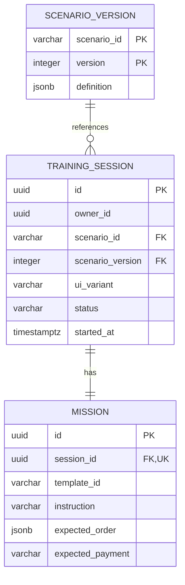

# Data model: training domain

The composite FK pins the catalog version. Mission session_id is unique. Application transaction guarantees a mission accompanies a new session. Owner ID is server-side and unrelated to names, age or contact details. The owner index supports future session lookup. No event table or grading result yet. Future migration adds completion fields and event constraints. PostgreSQL integration verified in CI 45772148779: migration, foreign key, concurrent isolated sessions, and immutable stored scenario version passed. Each bundled scenario is also seeded and checked during startup; keep old version fixtures available.
