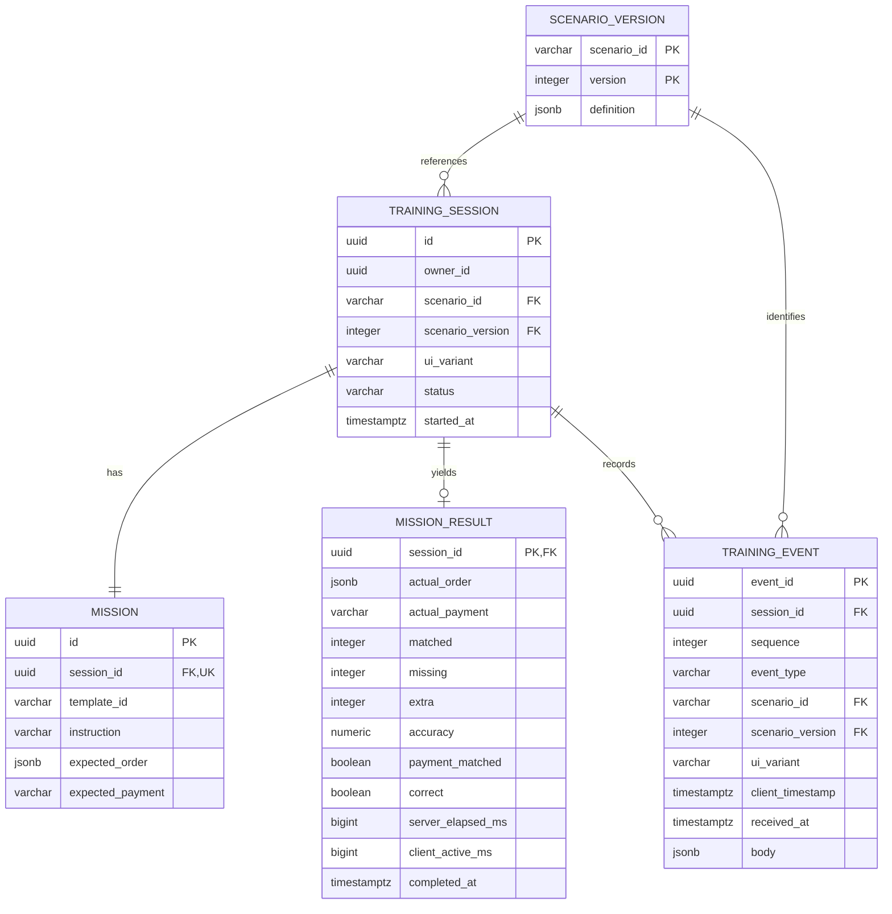

# Data model: training domain

The composite FK pins the catalog version. Mission session_id is unique. Application transaction guarantees a mission accompanies a new session. Owner ID is server-side and unrelated to names, age or contact details. The owner index supports future session lookup. Flyway V2 adds mission_result, with session_id as its primary and foreign key. A session can have zero results while active or cancelled, and exactly one after successful completion through the service. CHECK constraints enforce accuracy, counts and correctness. Status and result change in one transaction. Flyway V3 adds training_event. PostgreSQL integration verified in CI 45772148779: migration, foreign key, concurrent isolated sessions, and immutable stored scenario version passed. Each bundled scenario is also seeded and checked during startup; keep old version fixtures available.

V2 migration and grading transaction tests passed on real PostgreSQL in run 45773475536. An intentional contract drift failure was observed after adding endpoints; the generated spec is now committed and must pass strict re-verification.

EXECUTION 04 uses existing status field for ACTIVE -> CANCELLED; no new database migration is required. Cancel uses the same FOR UPDATE lock as grading. PostgreSQL race test verifies exactly one terminal transition, with one mission_result only when completion wins. Event ingestion adds V3 without changing existing status constraints.

V3: training_event has event_id primary key, (session_id, sequence) unique and composite scenario FK. The JSONB body is immutable and schema-validated. Server received_at and client_timestamp are distinct. A rejected batch must leave no new rows; exact replay returns ACK. Actual V3 integration verification pending.
