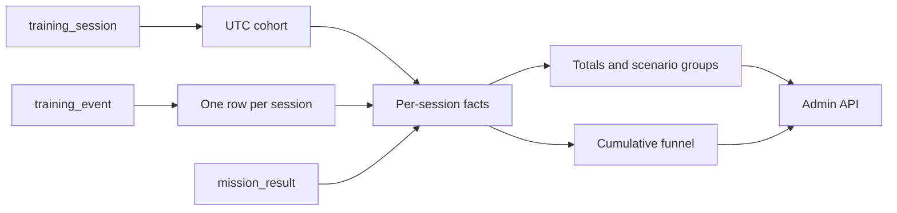

# Administrator report definitions

GET /api/admin/funnel?from=YYYY-MM-DD&to=YYYY-MM-DD&scenarioId=boram-cafe&version=1

UTC date filter includes start and excludes end. Default last 30 UTC calendar days including today. Maximum 366 days; version requires scenarioId. Report is a current snapshot of sessions started within the date range, not a count of events occurring within the range. The same snapshot includes scenario/version groups.

| Metric | Definition |
|---|---|
| Total | Count of cohort session IDs |
| Completed | status COMPLETED |
| Cancelled | status CANCELLED |
| Active | status ACTIVE and latest server-received event or start less than 30 minutes ago |
| Abandoned | status ACTIVE and latest server-received event or start at least 30 minutes ago |
| Successful | completed session with result.correct |
| Graded | completed sessions with stored accuracy/result |
| Success rate | successful / graded; null for zero denominator |
| Average accuracy | average of completed stored result accuracy; null without results |
| Average server time | average server_elapsed_ms of completed stored results, milliseconds |
| Helped | distinct sessions with HELP payload.open=true |

Total = completed + cancelled + active + abandoned. The report never changes session status. Late arrivals can revise reported stage coverage and the activity estimate. No owner ID or event payload is returned.

## Cumulative observed stages

START = total; MISSION = observed transition to MISSION; MENU = MISSION and observed MENU; CART = prior and observed CART; PAYMENT = prior and observed PAYMENT; COMPLETE = prior and server COMPLETED with a result. Counts are nested even when events arrive out of order; this is coverage, not a strict path-sequence analysis. Repeat transitions and retransmission do not increase the distinct session count. Conversion = current / previous, null when previous is zero or no predecessor. Not reached next = current - next, null for last stage. Includes still-active and cancelled sessions, not a count of confirmed abandonment. Server completed metric may exceed observed funnel COMPLETE when telemetry is missing.

Fixture acceptance (not live results): five cafe sessions in a fixed historical UTC cohort, two completed, one cancelled, one stale active, one late-event recent active; one success, mean accuracy .75, mean server time 2000 ms, one helped; cumulative stages 5/5/4/2/1/1. Additional burger and end-boundary rows test filtering. Tests also cover an empty cohort, invalid dates, authorization and EXPLAIN. Fixture rows in integration tests roll back. Actual results are recorded separately.

No load benchmark, causal conclusions, real participant experiments or personal data collection. The 30-minute threshold is a design choice, not empirically calibrated.
