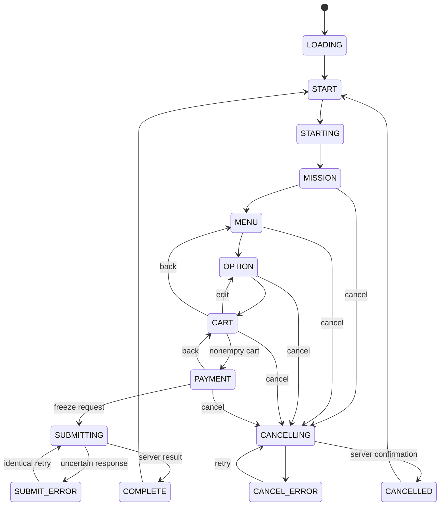

# Kiosk workflow

Help toggles within a state. Invalid events are ignored. Loading and starting failures have retry paths. A missing server session leads to EXPIRED and an explicit restart. Cancellation after an uncertain submission can conflict if completion won; retry the original submission to recover its result. No edit after frozen submission. The user can change options and quantity via cart edit before checkout.
